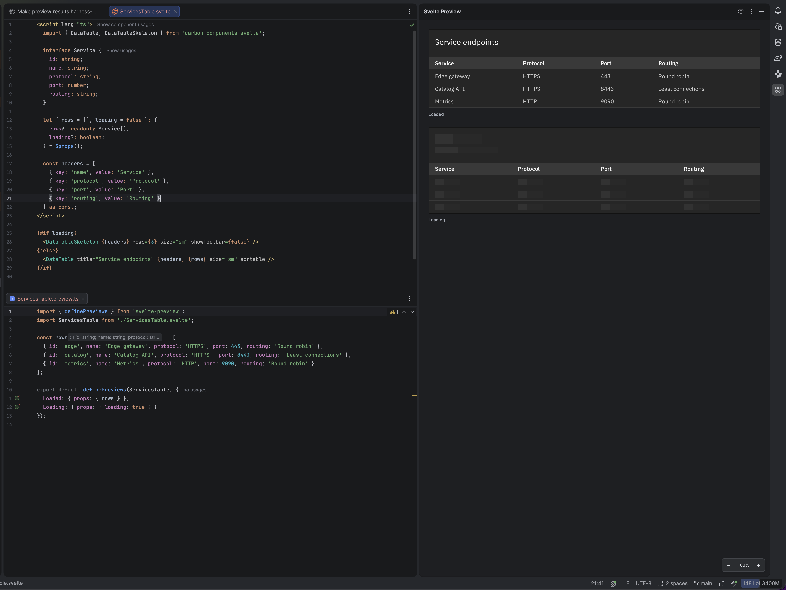

# Svelte Preview

SwiftUI-style component previews for Svelte 5 in IntelliJ-based IDEs. View multiple states side by side, interact with each independently, and see changes after saving.



## Install

Requires **IntelliJ Platform 2026.3+** with the **JavaScript and TypeScript** plugin, **Svelte 5.46.4+**, **Node.js 22.12+ or 24+**, and **pnpm 10.32.1**. Building the IDE plugin also requires **JDK 25**.

The plugin and runtime are not published yet. From a local checkout of this repository:

```sh
pnpm install
pnpm build:plugin
```

In the IDE, choose **Settings → Plugins → gear → Install Plugin from Disk**, select `plugin/build/distributions/svelte-preview-0.1.2.zip`, and restart if prompted.

In the Svelte project's package directory, install the runtime from the checkout:

```sh
pnpm add -D /absolute/path/to/svelte-preview/packages/runtime
```

## Use

1. Open a `.svelte` component and select **View → Tool Windows → Svelte Preview**. The local server starts automatically.
2. Click **Create preview** if the component has no preview file yet, or create a neighbouring `ComponentName.preview.ts` or `.preview.js` yourself.
3. Define named states with their props. Save to refresh the preview.

For example, beside `ProductCard.svelte`:

```ts
import { definePreviews } from 'svelte-preview';
import ProductCard from './ProductCard.svelte';

// Supply sample data for the component's states.
const product = { name: 'Studio headphones', price: 129, available: true };

// Render each state in its own interactive frame.
export default definePreviews(ProductCard, {
  Default: { props: { product } },
  Loading: {
    props: { product: null, loading: true },
    viewport: { width: 320, height: 340 }
  },
  Unavailable: { props: { product: { ...product, available: false } } }
});
```

Every state needs a `props` object; use `{}` for components without inputs. TypeScript definitions check props against the component. Set `viewport` per state to test different sizes.

The panel follows the selected component. It temporarily hides for other file types and returns when you select a `.svelte` file. Manually closing it keeps it hidden until you enable it again. Toggle it for the project with **Tools → Toggle Svelte Preview**, **⌘⌥⇧P** on macOS, or **Ctrl+Alt+Shift+P** on Windows/Linux. Hidden previews stop the server. Use the bottom-right controls to zoom, and click the percentage to reset to 100%.

The preview settings menu offers **Refresh**, **Create preview**, **Open in browser**, and **Restart**. Choose a Node.js interpreter under **Settings → Tools → Svelte Preview**, then restart the preview server.

## Mock requests

Register fetch responses in a state's synchronous `setup` hook, before the component initializes:

```ts
Loaded: {
  props: {},
  setup({ http }) {
    http.get('/api/products', {
      body: [{ name: 'Studio headphones', price: 129, available: true }]
    });
  }
}
```

Use `{ pending: true }` for loading, `{ status: 503 }` for an error, or `{ body: null }` for an empty response. Other HTTP methods work too, such as `http.post`. Responses are isolated per frame; unmatched requests use the network as usual. See [ProductBrowser.preview.ts](examples/demo/src/lib/ProductBrowser.preview.ts) for all four states.

## Configure

Optionally add `svelte-preview.config.ts` beside the project's `package.json`:

```ts
import { defineConfig } from 'svelte-preview';

export default defineConfig({
  styles: ['./src/app.css'],
  theme: 'auto',
  viewport: { width: 360, height: 340 },
  aliases: { '@ui': './src/lib/ui' }
});
```

Paths resolve from the package root, and `$lib` maps to `src/lib` automatically. Theme accepts `auto`, `light`, or `dark`; auto follows the IDE or browser appearance. Restart after changing aliases or Svelte compiler settings.

The runtime uses `svelte.config.js` but its own Vite setup. Supply ordinary or precompiled CSS; application Vite plugins, SvelteKit `$app/*` modules, route loading, and form actions are not supported yet.

## Try the demo or browser preview

From this checkout:

```sh
pnpm install
pnpm dev
```

Open <http://127.0.0.1:4317> and choose `ProductCard.svelte` or `ProductBrowser.svelte`. To try the IDE integration, open either component under `examples/demo/src/lib` and show the Svelte Preview tool window.

For a browser preview in your own project, run:

```sh
pnpm exec svelte-preview --root . --port 4317
```
