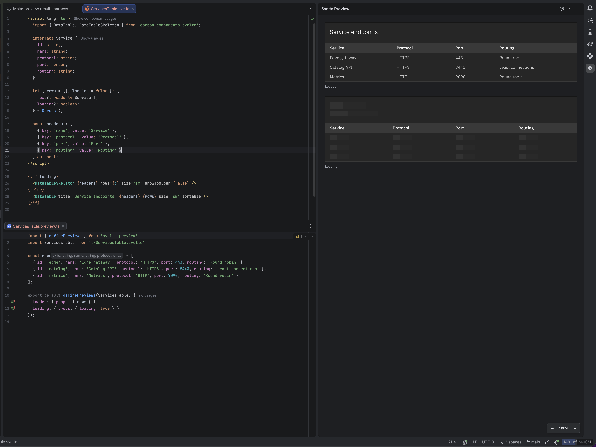

# Svelte Preview

Interactive component previews for Svelte 5. Define typed props and named states, mock HTTP requests, and preview components in a browser or beside your editor with the Svelte Preview JetBrains plugin.



## Install

Requires Svelte 5.46.4+ and Node.js 22.12+ on the 22.x line, or Node.js 24+.
Install in your Svelte project's package directory:

```sh
pnpm add -D svelte-preview
```

## Define component states

Create `ProductCard.preview.ts` beside `ProductCard.svelte`:

```ts
import { definePreviews } from 'svelte-preview';
import ProductCard from './ProductCard.svelte';

export default definePreviews(ProductCard, {
  Default: { props: { product: { name: 'Headphones', price: 129, available: true } } },
  Loading: { props: { product: null, loading: true } }
});
```

Supply the props your component actually accepts. Every state needs a `props` object; use `{}` for components without inputs.

## Open the preview

Run a browser preview from your Svelte project's package directory:

```sh
pnpm exec svelte-preview --root . --port 4317
```

Open <http://127.0.0.1:4317>. For IDE previews, install the [Svelte Preview JetBrains plugin](https://github.com/n1ckl0sk0rtge/svelte-preview/releases/latest), open a Svelte component, and choose **View → Tool Windows → Svelte Preview**. The plugin requires IntelliJ Platform 2026.3+ with the JavaScript and TypeScript plugin and JCEF.

The runtime is installed per project and versioned independently from the IDE plugin. Commit your dependency and lockfile changes with your project.

See the [documentation](https://github.com/n1ckl0sk0rtge/svelte-preview#configure) for global styles, Tailwind, SCSS, HTTP mocks, setup hooks, and SvelteKit fixtures. Report problems through [GitHub Issues](https://github.com/n1ckl0sk0rtge/svelte-preview/issues).

## Install the agent skill

For standalone previews or when your harness has no IntelliJ MCP connection, run this command from your project directory.

```sh
pnpm exec svelte-preview install-skill
```

This installs the bundled `$svelte-preview` skill at `.agents/skills/svelte-preview/SKILL.md`. It teaches agents how to define and configure previews and how to inspect them in a browser or IntelliJ. In a monorepo, pass `--root <repo-directory>` to install it for the whole repository. Share the installed file with your team by committing it. Repeating the command keeps an identical file in place and reports a conflict if the existing skill differs.

An IntelliJ-connected harness gets the same guidance from `svelte_preview_inspect` with `include_guide: true`. [IntelliJ MCP workflow](https://github.com/n1ckl0sk0rtge/svelte-preview#inspect-from-an-intellij-connected-agent)

## Inspect with a browser harness

Start `pnpm exec svelte-preview --root . --port 0` in the Svelte package directory and read the `url` from the JSON on the `SVELTE_PREVIEW_READY ` stdout line. The server listens on loopback, so run the browser where it can reach that address.

Open `/?file=<component>` to discover states. The `file` parameter is a path relative to the Svelte package. When the gallery is ready, each `iframe[data-preview-state]` has the exact state name in `data-preview-state`, its URL in `src`, and a JSON value in `data-preview-viewport`. The viewport is either `"auto"` or an object with `width` and `height` in CSS pixels.

If you already know the state, open `/__preview/frame?file=<component>&state=<name>` directly. Use `URLSearchParams` to encode the path and name. Set the browser's viewport to the configured dimensions for a fixed-size preview, or choose dimensions for an automatic preview.

Read `data-preview-status` on the document's `<html>` element. It starts at `loading`. A gallery reports `ready` when its state list is available. A state frame reports `mounted` after the initial Svelte mount. Wait for the specific UI you expect after that, since asynchronous work may still be running. For either page, `missing` means the component has no neighboring preview definition, `paused` means live reload was paused by rapid edits, and `error` provides a message in `[data-preview-error]`. Check the HTTP response too, since invalid component paths return an HTTP error.

This Playwright example uses an existing `page` and the demo's **Loaded** state.

```js
async function openPreview(url, expected) {
  // Check the document response, then wait for the runtime to report its status.
  const response = await page.goto(url);
  if (!response?.ok()) throw new Error(`Preview request failed: ${response?.status()}`);
  const rendered = page.locator('html[data-preview-status]:not([data-preview-status="loading"])');
  const status = await rendered.getAttribute('data-preview-status', { timeout: 15_000 });
  if (status === 'error') throw new Error(await page.locator('[data-preview-error]').innerText());
  if (status !== expected) throw new Error(`Preview status: ${status}`);
}

// Read the state link and viewport from the gallery.
const gallery = new URL('/', baseUrl);
gallery.searchParams.set('file', 'src/lib/ProductBrowser.svelte');
await openPreview(gallery.href, 'ready');
const frame = page.locator('iframe[data-preview-state="Loaded"]');
const { url, viewport } = await frame.evaluate((element) => ({
  url: element.src,
  viewport: JSON.parse(element.dataset.previewViewport)
}));

// Mount the state at its configured size and wait for the expected UI.
if (viewport !== 'auto') await page.setViewportSize(viewport);
await openPreview(url, 'mounted');
await page.getByRole('heading', { name: 'Studio headphones' }).waitFor();
```

## License

[Apache License 2.0](https://github.com/n1ckl0sk0rtge/svelte-preview/blob/main/LICENSE).
